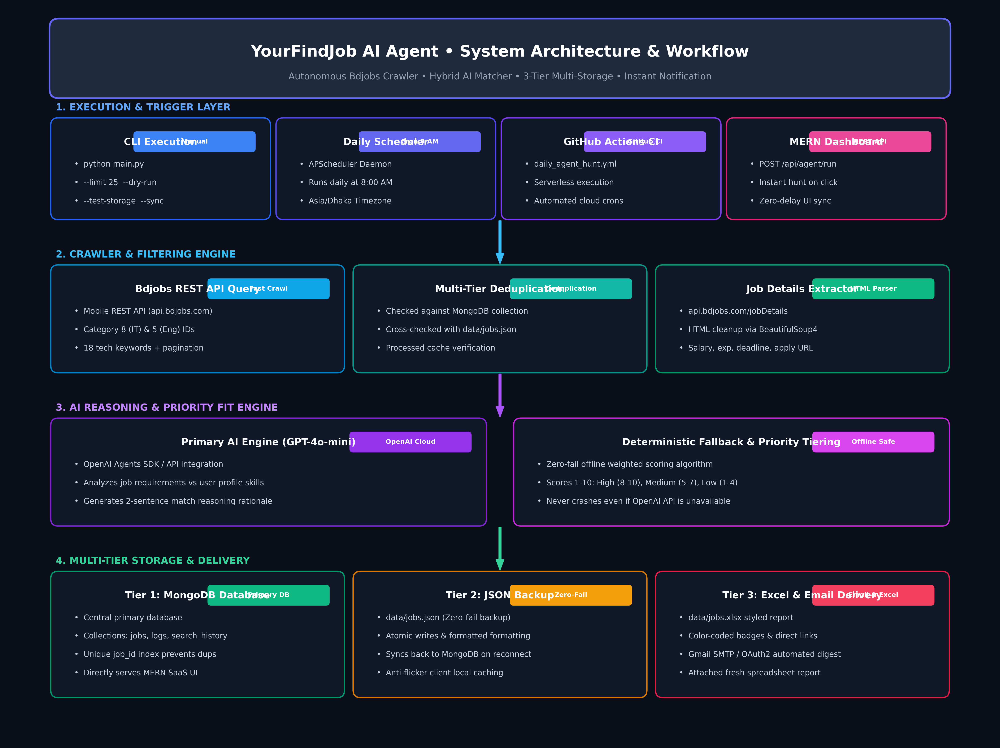

# FindYourJob AI Agent 🤖💼

> **Your Personal AI Job Hunting Assistant**  
> *An autonomous AI agent that aggregates daily technology jobs from Bdjobs.com, evaluates profile match suitability with hybrid AI scoring, persists records across a 3-tier fault-tolerant storage pipeline (MongoDB + JSON + Excel), and delivers structured email digests.*

---

## 📌 Table of Contents
1. [Project Overview & How It Works](#1-project-overview--how-it-works)
2. [Multi-Tier Storage Architecture](#2-multi-tier-storage-architecture)
3. [MongoDB Database & Collections](#3-mongodb-database--collections)
4. [Project Directory Structure](#4-project-directory-structure)
5. [Installation & Setup Guide](#5-installation--setup-guide)
6. [Configuration & Environment Variables](#6-configuration--environment-variables)
7. [Testing & CLI Command Reference](#7-testing--cli-command-reference)
8. [OpenAI API & Gmail Notification Setup](#8-openai-api--gmail-notification-setup)
9. [Daily Automation Scheduler](#9-daily-automation-scheduler)
10. [Fault-Tolerant Offline Fallback & Recovery](#10-fault-tolerant-offline-fallback--recovery)
11. [MERN Stack SaaS Web Integration](#11-mern-stack-saas-web-integration)
12. [Safety, Reliability & Ethical Standards](#12-safety-reliability--ethical-standards)
13. [Troubleshooting Guide](#13-troubleshooting-guide)

---

## 1. Project Overview & How It Works

**YourFindJob AI Agent** is a production-grade Python automation service engineered to crawl, analyze, rank, and report fresh tech job openings from Bangladesh's premier employment portal, **Bdjobs.com**.

### Execution Pipeline:
1. **Automated Search (`search_bdjobs`)**: Queries the official Bdjobs mobile REST API endpoints (`api.bdjobs.com`) across configured tech categories (Category 8: IT & Category 5: Engineering) and 18 technology keywords (*Python, React, Node, Full Stack, SQA, DevOps, AI, etc.*) with multi-page pagination.
2. **Multi-Tier Deduplication (`check_duplicate_jobs`)**: Cross-checks candidates against MongoDB, `data/jobs.json`, `data/processed_jobs.json`, and `data/jobs.xlsx` to ensure no job is ever re-processed or reported twice.
3. **Deep Details Extraction (`read_job_details`)**: Fetches full job specifications, extracts requirements, experience levels, education, compensation, deadlines, and direct apply links, sanitizing markup using BeautifulSoup4.
4. **AI Matching & Priority Fit Scoring (`analyze_job_match`)**: Evaluates job descriptions against user-defined profile preferences using a 10-point scale:
   - **High Priority (8–10)**: Strong alignment with primary technical skills and qualifications.
   - **Medium Priority (5–7)**: Moderate overlap with transferable experience.
   - **Low Priority (1–4)**: Peripheral relevance.
5. **Multi-Tier Persistence (`save_to_all_storages`)**: Concurrently writes new records to:
   - **Tier 1 (Primary Database)**: MongoDB (`yourfindjob_db`).
   - **Tier 2 (Zero-Fail Local Backup)**: JSON store (`data/jobs.json`).
   - **Tier 3 (Formatted Report)**: Excel workbook (`data/jobs.xlsx`).
6. **Automated Email Notifications (`send_job_email`)**: Compiles high-priority discoveries into a responsive HTML email digest with the formatted Excel report attached and delivers it directly to your Gmail inbox.

---

## 2. Multi-Tier Storage Architecture



To guarantee high availability and prevent data loss, YourFindJob employs a resilient 3-tier storage architecture:

| Storage Tier | Technology | Purpose & Role | Destination Path / Collection |
|---|---|---|---|
| **Tier 1: Primary Database** | **MongoDB (PyMongo)** | Fast indexed querying, central persistence, and live API serving | `yourfindjob_db` |
| **Tier 2: Local Backup** | **JSON Storage** | Offline-safe, atomic fallback preserving data during DB downtime | `data/jobs.json` |
| **Tier 3: Executive Report** | **Excel (.xlsx)** | Formatted, color-coded spreadsheet with clickable apply hyperlinks | `data/jobs.xlsx` |

---

## 3. MongoDB Database & Collections

The primary database (`yourfindjob_db`) consists of 4 distinct collections:

1. **`jobs`**: Complete record of each discovered job listing, containing title, company, location, salary, experience, match score, priority rating, requirements, deadline, application URL, and timestamp. A unique index on `job_id` guarantees zero duplicates.
2. **`processed_jobs`**: Historical ledger of processed job IDs to optimize subsequent crawling cycles.
3. **`search_history`**: Audit trail of execution sessions, recording queries, timestamps, total discovered items, and newly persisted jobs.
4. **`agent_logs`**: Internal diagnostic logs, execution events, and runtime trace information.

---

## 4. Project Directory Structure

```text
YourFindJob-AI-agent/
│
├── main.py                    # Main CLI harness (execution flags & self-tests)
├── agent.py                   # OpenAI Agents SDK implementation & multi-tier orchestration
├── config.yaml                # Profile preferences, tech keywords, and schedule config
├── requirements.txt           # Python dependencies (PyMongo, OpenAI, OpenPyXL, etc.)
├── .env                       # Environment secrets (API keys, Gmail, MongoDB URI)
├── .env.example               # Template environment configuration file
├── .gitignore                 # Version control exclusion rules
├── architecture_diagram.png   # 300 DPI high-resolution architecture diagram
├── README.md                  # Comprehensive English documentation
├── README-2.md                # In-depth technical architecture specification
│
├── database/                  # Database connectivity modules
│   ├── __init__.py
│   ├── mongodb.py             # MongoDB client, ping checks, and index manager
│   └── sync_manager.py        # Offline JSON <--> MongoDB synchronization engine
│
├── tools/                     # Modular agent capability tools
│   ├── __init__.py
│   ├── bdjobs_search.py       # Tool 1: Bdjobs REST API multi-query scraper
│   ├── job_details.py         # Tool 2: Deep job description & requirement parser
│   ├── duplicate_checker.py   # Tool 3: Cross-tier deduplication filter
│   ├── job_analyzer.py        # Tool 4: Hybrid AI fit scoring & reasoning engine
│   ├── excel_manager.py       # Tool 5: Styled Excel workbook generator (.xlsx)
│   ├── email_sender.py        # Tool 6: Responsive HTML email & attachment dispatcher
│   ├── mongodb_manager.py     # MongoDB CRUD operations & audit logger
│   └── json_manager.py        # Atomic local JSON storage manager
│
├── data/                      # Persistent storage & exported reports
│   ├── jobs.json              # Local JSON backup of all collected jobs
│   ├── processed_jobs.json    # Deduplication cache
│   ├── jobs.xlsx              # Formatted Excel spreadsheet
│   └── email_preview.html     # Dry-run email preview output
│
├── logs/
│   └── yourfindjob.log        # Detailed terminal execution log
│
└── scheduler/
    ├── __init__.py
    └── daily_scheduler.py     # Background automation daemon (8:00 AM Asia/Dhaka)
```

---

## 5. Installation & Setup Guide

### 1. Clone & Set Up Virtual Environment
```bash
# Navigate to project directory
cd YourFindJob-AI-agent

# Create and activate a Python virtual environment (recommended)
python -m venv venv
# On Windows:
.\venv\Scripts\activate
# On Linux / macOS:
source venv/bin/activate
```

### 2. Install Dependencies
```bash
pip install -r requirements.txt
```

### 3. Initialize Environment Variables
```bash
copy .env.example .env
# On Linux / macOS:
cp .env.example .env
```

---

## 6. Configuration & Environment Variables

Edit the `.env` file to supply your credentials:

```env
# MongoDB Configuration (Local or Cloud Atlas)
MONGODB_URI=mongodb://localhost:27017/
MONGODB_DB_NAME=yourfindjob_db
MONGODB_TIMEOUT_MS=3000

# OpenAI API Configuration
OPENAI_API_KEY=sk-proj-your-openai-api-key-here
OPENAI_MODEL=gpt-4o-mini

# Gmail Notification Configuration (SMTP with App Password)
GMAIL_SENDER_EMAIL=your_email@gmail.com
GMAIL_APP_PASSWORD=your_16_character_app_password
GMAIL_RECIPIENT_EMAIL=your_email@gmail.com
```

> **Note on AI Resilience:** If `OPENAI_API_KEY` is not provided, the agent automatically activates its built-in **Deterministic Scoring Engine** to calculate accurate weighted fit scores without interrupting the workflow.

---

## 7. Testing & CLI Command Reference

The agent includes dedicated CLI flags for granular component testing and validation:

### 1. Test MongoDB Connectivity & Indexes (`--test-db`)
Validates database connection, collection creation, and index initialization:
```bash
python main.py --test-db
```

### 2. Test Local JSON Backup Storage (`--test-json`)
Verifies atomic writes, schema structure, and deduplication logic:
```bash
python main.py --test-json
```

### 3. Run the Full Multi-Tier Storage Suite (`--test-storage`)
Tests MongoDB, JSON, Excel generation, and simulates graceful offline fallback:
```bash
python main.py --test-storage
```

### 4. Synchronize Offline Data (`--sync`)
Uploads pending jobs saved in `data/jobs.json` to MongoDB after database reconnection:
```bash
python main.py --sync
```

### 5. Execute an On-Demand Dry Run (`--dry-run --limit 5`)
Discovers up to 5 fresh technology jobs, performs match scoring, and saves to all storage tiers without dispatching live emails:
```bash
python main.py --dry-run --limit 5
```

---

## 8. OpenAI API & Gmail Notification Setup

### OpenAI API Key
1. Obtain an API key from the [OpenAI Platform](https://platform.openai.com/api-keys).
2. Configure `OPENAI_API_KEY` and `OPENAI_MODEL=gpt-4o-mini` in `.env`.

### Gmail App Password Setup
To allow the agent to send automated email reports via your Gmail account:
1. Navigate to your [Google Account Security Settings](https://myaccount.google.com/security).
2. Ensure **2-Step Verification** is enabled.
3. Search for **App Passwords** or visit [myaccount.google.com/apppasswords](https://myaccount.google.com/apppasswords).
4. Create an App Password with the name `YourFindJob`.
5. Paste the generated 16-character password into `GMAIL_APP_PASSWORD` in `.env`.

---

## 9. Daily Automation Scheduler

To start the agent as a background daemon that automatically runs every morning at **8:00 AM (Asia/Dhaka time)**:

```bash
python main.py --scheduler
```

The scheduler uses **APScheduler** to execute recurring job discovery, update spreadsheets, write to MongoDB, and deliver morning email digests without requiring manual intervention.

---

## 10. Fault-Tolerant Offline Fallback & Recovery

If MongoDB becomes unreachable due to a network disruption or server restart:
1. **Zero-Crash Resilience**: The agent catches connection timeouts gracefully and continues execution.
2. **Local Fallback Activation**: Unsynced records are tagged with `synced_to_db: false` and saved directly to `data/jobs.json`.
3. **Report Continuity**: The Excel report (`data/jobs.xlsx`) and email digests continue to generate as scheduled.
4. **One-Command Recovery**: When MongoDB is online again, execute:
   ```bash
   python main.py --sync
   ```
   This automatically pushes all offline records into MongoDB and updates their synchronization flags.

---

## 11. MERN Stack SaaS Web Integration

The AI Agent integrates seamlessly with the **YourFindJob MERN Stack SaaS Web Application**, sharing a common MongoDB database:

- **Real-Time Data Feeding**: Discovered jobs appear instantaneously on the React frontend.
- **On-Demand Dashboard Triggers**: Administrators can trigger crawler hunts directly from the web browser via `POST /api/agent/run`.
- **Bidirectional Settings Sync**: Changes made to skills or search preferences in the web settings panel synchronize directly with `config.yaml` and MongoDB.

---

## 12. Safety, Reliability & Ethical Standards

1. **Non-Invasive API Access**: Queries official public REST API endpoints without triggering rate limits or bypassing access controls.
2. **Bandwidth Efficiency**: Light JSON payloads eliminate the overhead and resource waste associated with heavy headless browser rendering.
3. **No Automated Submissions**: The agent only discovers, scores, and notifies—it never submits applications autonomously on your behalf.
4. **Atomic File Operations**: Prevents data corruption during simultaneous read/write cycles.

---

## 13. Troubleshooting Guide

| Issue Encountered | Likely Cause | Resolution Steps |
|---|---|---|
| `MongoDB Server Ping FAILED` | MongoDB service is not running | Start the service using `net start MongoDB` (Windows) or `sudo systemctl start mongod` (Linux), or check your `MONGODB_URI`. |
| `Excel Permission Denied` | `data/jobs.xlsx` is currently open in Microsoft Excel | Close Excel and re-run. (The agent automatically saves a safety backup at `jobs_latest.xlsx`). |
| `Gmail Authentication Error` | Standard password used instead of an App Password | Generate a 16-character Google App Password from your Google Account Security dashboard. |
| `OpenAI RateLimit / Quota Exceeded` | OpenAI API account quota depleted | The agent automatically falls back to its built-in deterministic scoring algorithm with zero downtime. |

---

<p align="center">
  <b>YourFindJob</b> — Autonomous Multi-Tier AI Job Hunting Assistant.
</p>
